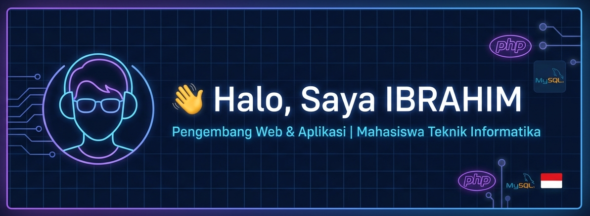
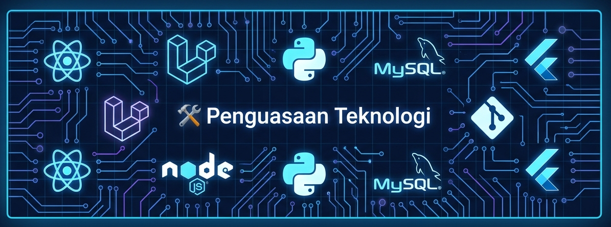
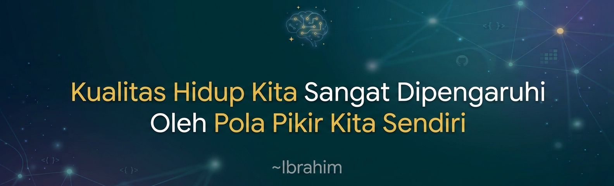

---

<table>
<tr>
<td width="35%" valign="top">

## 🌟 Tentang Saya

> *"Selesaikan dulu masalahnya. Baru kemudian tulis kodenya."*

👋 Halo, saya **Ibrahim**.

💻 Tertarik pada teknologi, pemrograman, dan pengembangan aplikasi.

🌱 Aktif belajar Web Development dan Mobile Development.

🎯 Membuat aplikasi yang bermanfaat, responsif, dan user-friendly.

📍 Indonesia

### 🌐 Hubungi Saya

</td>

<td width="65%" valign="top">

## 📊 Statistik GitHub

### 📊 Statistik GitHub

  
  

</td>
</tr>
</table>

---

## 🔥 GitHub Contribution Streak

---

## 🛠️ Penguasaan Teknologi

### 💻 Programming Languages

### ⚙️ Framework & Tools

### 🗄️ Database

---

### 🏆 GitHub Trophies

  

## 💡 Kutipan Pilihan Pengembang
> *"Kualitas hidup kita sangat dipengaruhi oleh pola pikir kita sendiri.."*
>
> **— Ibrahim**

---

### 💜 Terus Belajar, Terus Berkarya, dan Terus Berkembang.

**Thank you for visiting my GitHub profile!**

